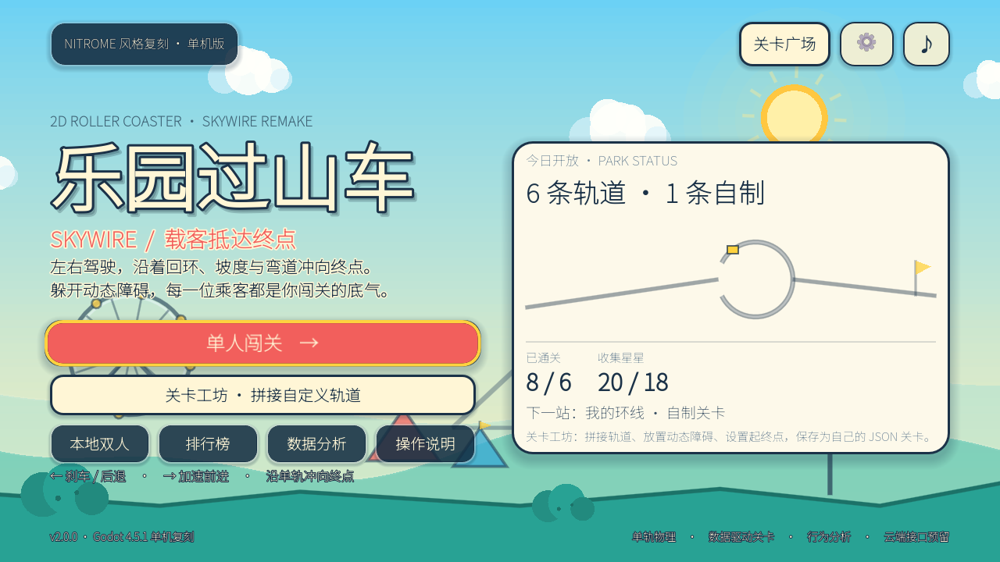
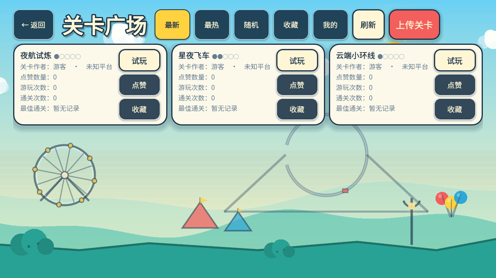
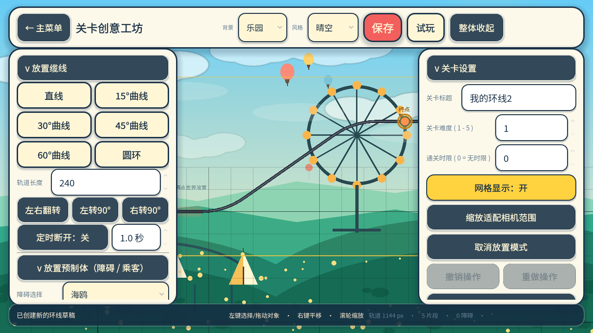
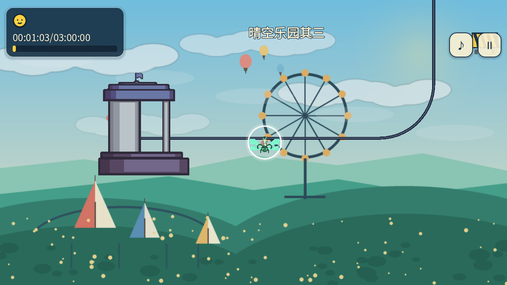
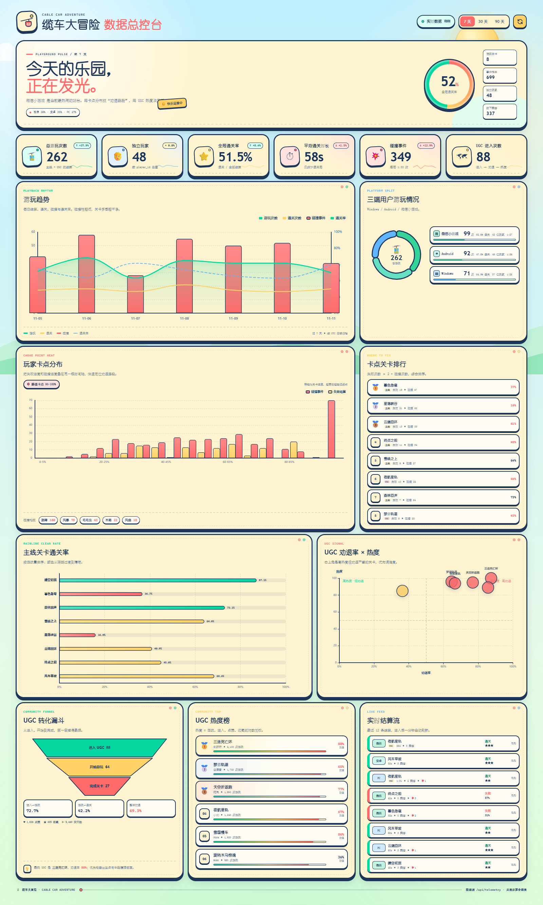

# 缆车大冒险 · Skywire Remake

**一条连续轨道、左右两个方向键：控制缆车加减速，靠坡度与惯性穿过环圈和障碍，把乘客安全送到终点。**

一个用 **Godot 4.5.1** 制作的 2D 单轨过山车闯关项目，同时包含关卡工坊、联网关卡广场、本地双人分屏、行为数据分析与数据看板，可作为完整的游戏客户端 + 工具链 + 后端作品集。



---

## 已实现功能

### 核心玩法

- **单轨驾驶**：只有“右 / 前进加速”和“左 / 刹车后退”两个方向，速度、重力和摩擦共同决定过弯与爬坡手感；
- **连续轨道**：直线、15°/30°/45°/60° 曲线、竖直环圈自由拼接，支持空档、吸附、脱轨和飞行中重新落轨；
- **45 个关卡**：JSON 数据驱动，按晴空、黄昏、星夜、森林、雪山、云层、梦境等主题组织；
- **动态障碍**：海鸥、雷云、路障、木箱、风车、摩天轮、毛毛虫、松树、捕蝇草、雪精灵、冰晶、飞鸟、飞鱼、陨石、泡泡、炮弹等 23 种独立场景；
- **乘客系统**：乘客是生命值，撞击会掉客；支持起点上车、终点下车、受击弹飞；
- **定时断轨**：碰到断轨片段后倒计时预警，轨道下落淡出，缆车脱轨后仍可尝试重新落轨；
- **9 种缆车**：不同碰撞体、乘客数、免疫/护甲/冲刺等特性，按主线进度解锁；
- **结算与记录**：乘客数、用时、星级、历史最佳、独立排行榜；
- **本地双人分屏**：左右 / 上下分屏，P1 方向键、P2 WASD，支持对手残影。

### 关卡工坊

- 轨道类型、长度、左右翻转、旋转、定时断开；
- 连续放置、端点吸附、网格吸附、轨道/障碍/乘客拖动；
- 起点、终点任意弧长设置，支持正向与反向线路；
- 障碍与乘客使用真实纹理和运动轨迹预览；
- 撤销 / 重做、删除选中对象、一键试玩、保存到 `user://levels/custom_*.json`；
- 开发者模式可新建并保存内置 `level_XX` 草稿。

### 关卡广场（UGC）

- 上传自己通关过的自制关卡，每个账号最多 3 张；
- **最新 / 最热 / 随机 / 收藏 / 我的** 五种浏览方式；
- **服务端分页**：首屏只加载 24 张，滚动到底自动加载下一页，也可点“加载更多”，几百张关卡不会一次性创建全部卡片；
- **响应式卡片网格**：桌面 3 列、窄屏自动变为 2 列或 1 列、超宽屏最多 4 列，标题栏在窄屏自动换行；
- 点赞、收藏、游玩次数、通关次数与“最佳通关”成绩；
- 标题右侧显示 5 个难度圆点；点赞数量在作者下方；移除卡片上的冗余按钮与简介；
- 已上传关卡在上传弹窗中显示“撤销上传”，点击后使用与工坊删除关卡一致的 PaperPanel 二次确认；
- 上传后在工坊修改并保存的关卡会标记为“需重新通关”，撤销上传后也不能立即重传；
- 卡片、列表、详情分层：列表只取摘要，试玩时才下载完整关卡数据。

### 移动端与性能

- 微信小游戏 / Web / Android / Windows 多端导出；
- 微信端 **DPR 1.5**，背景与障碍 30Hz、持续接触检测 20Hz、粒子 40%、HUD 12Hz；
- 普通 Web（itch.io）为只读广场：隐藏上传入口与虚拟按键，仅保留键盘/鼠标浏览与试玩；
- 微信进度使用 `wx.setStorageSync` 持久化，并在结算时立即落盘，避免 WXMEMFS 延迟/重启丢档；
- 以缆车为中心 **1200px 世界距离**裁剪屏幕外障碍；热气球、陨石和正在触发的障碍保持活动；
- 触摸滚动支持 **惯性 + 指数阻尼**，拖动经过按钮/卡片时也能正常滚动；
- 虚拟方向键按 touch index 独立绑定，多指操作互斥优先级明确；
- 关卡片段、HUD、弹窗动画和存档落盘均针对移动端做过延迟与分批处理。

### 数据与后端

- 遥测事件：开局、碰撞、拾取、结算，本地 JSONL + 可选远端上报；
- 游戏内数据分析：KPI、趋势、碰撞热点、关卡统计、CSV 导出；
- 自适应难度：按最近 8 局表现调整障碍速度和引擎辅助；
- Node.js + Express + SQLite 后端：UGC 上传、审核状态、列表分页、详情、点赞、收藏、成绩、遥测汇总；
- Vue 3 + ECharts 数据看板：KPI、趋势、玩家卡点、UGC 漏斗与热度榜。

---

## 技术栈

| 模块 | 技术 |
|---|---|
| 游戏客户端 | Godot 4.5.1、GDScript、GL Compatibility 渲染器 |
| 关卡与编辑器 | 自研弧长参数化轨道几何、JSON 关卡格式、Godot Control 工坊 UI |
| UGC 后端 | Node.js 20、Express 5、better-sqlite3 |
| 数据看板 | Vue 3、Vite 6、ECharts 5、Axios |
| 离线分析 | Python 3、PySpark |
| 目标平台 | Windows、Web、微信小游戏、Android |
| 工程化 | 无头回归测试、自动截图、PowerShell 导出/打包脚本 |

---

## 本地运行

### 1. 运行游戏

需要 **Godot 4.5 或更高版本**（推荐 4.5.1）。

1. 打开 Godot，选择 **导入 / Import**；
2. 选择项目根目录的 [`project.godot`](project.godot)；
3. 等待资源首次导入，按 **F6 / F5** 运行。

也可以直接用命令行：

```bash
godot --path .
```

首次打开时 Godot 会生成 `.godot/` 本地产物；仓库提交 `.import` 侧车文件以固定资源 UID 与导入参数。

### 2. 运行回归测试

```bash
godot --headless --path . res://tests/test_runner.tscn
```

当前主测试集覆盖 **209 项检查**：轨道几何、驾驶、碰撞、断轨、工坊、广场分页/撤销、触摸惯性、相机帧模式、双人分屏、遥测等。

### 3. 启动 UGC 后端（可选）

```bash
cd server
npm install
cp .env.example .env
npm start
```

后端默认使用 SQLite；接口与 JSON 结构见 [`docs/UGC_API.md`](docs/UGC_API.md) 和 [`server/README.md`](server/README.md)。

### 4. 启动数据看板（可选）

```bash
cd dashboard
npm install
npm run dev
```

看板配置见 [`dashboard/README.md`](dashboard/README.md)。

### 操作

| 操作 | 按键 |
|---|---|
| 前进 / 加速 | `→` 或 `D` |
| 刹车 / 后退 | `←` 或 `A` |
| 暂停 | `Esc` / `P` |
| 重开 | `R` |
| 音乐开关 | `M` / HUD 按钮 |

---

## 项目结构

```text
skywire-remake/
├─ data/levels/                  # 45 个 JSON 关卡与索引
├─ assets/                       # 贴图、字体、乘客/缆车配置
├─ scenes/
│  ├─ game/                      # 游戏、HUD、轨道、障碍、乘客、起终点
│  ├─ ui/                        # 主菜单、选关、广场、结算、分析、设置
│  ├─ editor/                    # 关卡工坊
│  └─ carts/                     # 9 种缆车场景
├─ scripts/
│  ├─ data/                      # 轨道几何、关卡数据、目录
│  ├─ game/                      # 玩法与障碍逻辑
│  ├─ editor/                    # 工坊逻辑与世界绘制
│  ├─ autoload/                  # 输入、主题、音频、存档、遥测、路由
│  ├─ services/                  # 网络、UGC、存档、排行榜、分析
│  └─ ui/                        # UI 控制、惯性滚动、图表
├─ server/                       # Express + SQLite UGC / 遥测后端
├─ dashboard/                    # Vue 3 + ECharts 数据看板
├─ analytics/                    # PySpark 离线分析
├─ tests/                        # 无头回归测试
├─ tools/                        # 启动、测试、截图、导出脚本
└─ docs/                         # 接口、微信、性能与架构文档
```

---

## 截图

| 关卡广场 | 关卡工坊 |
|---|---|
|  |  |

| 环圈玩法 | 数据看板 |
|---|---|
|  |  |

更多截图在 [`.screenshots/`](.screenshots/)。

---

## 文档

- [UGC 关卡广场 API 与 JSON 结构](docs/UGC_API.md)
- [微信小游戏导入与性能档](docs/WECHAT_MINIGAME.md)
- [微信性能分析](docs/WECHAT_PERF_ANALYSIS.md)
- [Node.js 后端说明](server/README.md)
- [Vue 3 数据看板说明](dashboard/README.md)
- [第三方声明](THIRD_PARTY_NOTICES.md)

---

## 后续计划

- 替换占位美术与程序化音效，补齐正式动画、粒子和关卡演出；
- 工坊增加多选、复制粘贴、批量属性编辑与关卡缩略图；
- 广场增加搜索、标签筛选、举报与更完整的内容审核流程；
- 接入正式账号体系和云端排行榜，补全防作弊校验；
- 优化微信真机帧率与首屏加载，继续拆分资源与按需加载；
- 为 GitHub Actions 增加导出与无头回归的 CI 流程；
- 补充英文界面与更多辅助功能选项。

---

## 当前边界

- 美术、音效仍以可替换的占位资源和程序化音频为主；
- 本地双人分屏目前使用键盘，触屏双人尚未接入；
- 微信 UGC 文本审核目前为 mock 通过，正式上线需接入 `msgSecCheck`；
- 微信正式版需要备案 HTTPS 域名并配置 request 合法域名；
- 数据看板与游戏内分析页使用同一套口径，但数据源相互独立。

> 本仓库不包含原版 *Skywire* 的美术、音频、关卡或代码；玩法参考仅用于学习与作品集展示。
