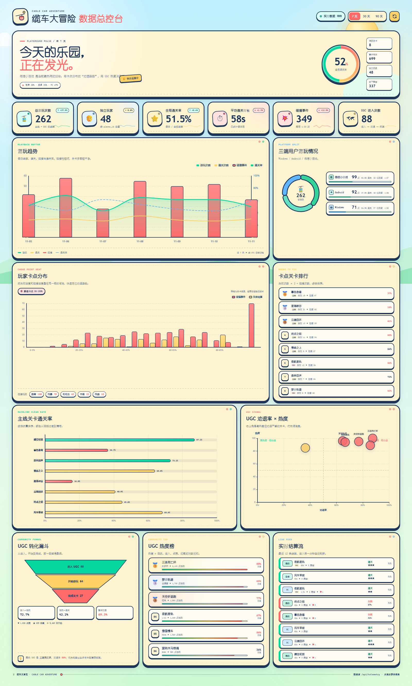

# 缆车大冒险 · 数据总控台

Vue 3（Composition API）+ ECharts 5 + Axios 实现的运营看板。数据来自 Godot 客户端
`POST /api/telemetry` 落库的 `run_end`、`enter_custom_level`、`collision` 事件，以及
`ugc_levels` 的广场元数据。



## 1. 启动

### 1.1 启动后端

```powershell
cd server
npm install
Copy-Item .env.example .env
npm start
```

默认监听 `http://127.0.0.1:3000`，数据库为 `server/data/cablecar.sqlite`。
后端已通过 `cors` 中间件统一处理跨域（`Access-Control-Allow-Origin`、
`Access-Control-Allow-Methods`、`Access-Control-Allow-Headers`），前端不需要额外配置。

### 1.2 灌入一份演示数据（可选）

```powershell
cd server
$env:UGC_DB_PATH="$PWD\data\dashboard_demo.sqlite"
npm run seed:demo
$env:PORT="3100"
node src/server.js
```

演示库与正式库分离，文件名必须包含 `demo`；脚本不会碰正式数据库。

### 1.3 启动 Vue

```powershell
cd dashboard
npm install
npm run dev
```

打开 `http://127.0.0.1:5173/`。

Vite 默认把 `/api` 代理到 `http://127.0.0.1:3000`。如果后端演示库跑在 3100：

```powershell
$env:VITE_API_PROXY="http://127.0.0.1:3100"
npm run dev
```

### 1.4 生产构建

```powershell
cd dashboard
$env:VITE_API_BASE="https://your-domain.com/api"
npm run build
```

`dist/` 可直接交给 Nginx / 静态服务器。若前后端同域，`VITE_API_BASE` 留空即可使用相对路径 `/api`。

## 2. 目录结构

```text
dashboard/
├─ index.html
├─ vite.config.js              # /api 开发代理，生产由 VITE_API_BASE 控制
├─ package.json
├─ .env.example
└─ src/
   ├─ main.js
   ├─ App.vue                  # 页面编排、轮询、KPI 与数据分发
   ├─ api/dashboard.js         # Axios 封装
   ├─ composables/
   │  ├─ useEChart.js          # ECharts 按需注册 + ResizeObserver 自适应
   │  └─ useCountUp.js         # KPI 数字滚动
   ├─ components/
   │  ├─ AppHeader.vue         # 品牌、时间范围、刷新、LIVE 状态
   │  ├─ KpiCard.vue           # KPI 卡 + sparkline + 环比
   │  ├─ ChartCard.vue         # 奶油卡牌 / 空状态 / 页脚
   │  ├─ TrendChart.vue        # 游玩、通关、碰撞、通关率趋势
   │  ├─ PlatformPanel.vue     # 三端环形图 + 平台明细
   │  ├─ ProgressHeat.vue      # 关卡进度 5% 分桶卡点
   │  ├─ ChokeList.vue         # 卡点关卡排行
   │  ├─ MainLevelChart.vue    # 主线关卡通关率
   │  ├─ UgcScatter.vue        # UGC 劝退率 × 热度
   │  ├─ UgcFunnel.vue         # UGC 进入→游玩→完成漏斗
   │  ├─ UgcTable.vue          # UGC 热度榜
   │  └─ RecentRuns.vue        # 最近结算流
   ├─ styles/base.css          # 主题变量、天空渐变、噪点、滚动条
   └─ utils/format.js          # 数字/时长/平台/障碍标签
```

## 3. 数据口径

| 指标 | 口径 |
|---|---|
| 总游玩次数 | `run_end` 事件数 |
| 独立玩家 | `run_end` / `enter_custom_level` / `collision` 中 `player_id`（缺省回退 `session_id`）去重 |
| 通关率 | `completed = true` 的 `run_end` / 全部 `run_end` |
| 平均通关时长 | 仅 `completed = true` 的 `time_seconds` 均值 |
| 碰撞事件 | `collision` 事件数；`collisions_per_run = 碰撞数 / run_end 数` |
| 卡点进度 | `collision.track_progress` 与失败 `run_end.progress` 按 5% 分 20 桶 |
| 卡点排行分 | `失败次数 × 2 + 碰撞次数` |
| UGC 劝退率 | `(max(进入数, 结算数) - 通关数) / max(进入数, 结算数)`；没有进入事件时回退结算数 |
| UGC 热度 | `ln(1+plays)*0.34 + ln(1+max(enters,runs))*0.30 + ln(1+likes)*0.22 + ln(1+favorites)*0.14`，再归一化到 0–100 |
| 三端拆解 | 按 `platform` 分组：游玩次数、独立玩家、通关率、平均时长 |

后端聚合接口只返回聚合值，不返回 `player_id` / `session_id` 明细。

## 4. 接口

```http
GET /api/telemetry/dashboard?days=7
```

`days` 支持 `1–90`。响应包含：

- `kpis` / `deltas` / `previous`：全局 KPI 与上一周期环比；
- `trend`：按天补齐的游玩、通关、失败、碰撞、去重玩家；
- `platforms`：三端游玩情况；
- `main_levels`：主线关卡通关率、平均时长、碰撞；
- `collisions.progress_bins`：20 桶卡点；
- `choke_levels`：跨主线 + UGC 的卡点排行；
- `ugc.funnel` / `ugc.levels` / `ugc.top_heat`：UGC 漏斗、劝退率、热度；
- `recent_runs`：最近 12 条结算（不含玩家 ID）；
- `passengers`：救下 / 损失乘客总数。

## 5. 视觉与动效地图

**视觉规范**

- 天空蓝 → 浅绿渐变背景，固定漂浮 SVG 云朵、山丘和太阳；
- 奶油色卡片（`#FFF4D2`）+ 深海军蓝粗边框（3px）+ 24px 圆角；
- 硬底阴影（`0 7px 0 #1D3557`），不使用扁平淡阴影；
- 珊瑚红 / 明黄 / 薄荷绿作为按钮、图表和状态色；
- KPI 使用“成就徽章”结构：左侧图标，右侧数字，数字有滚动动画。

**动效位置（重点体验）**

| 位置 | 动画 |
|---|---|
| 页面顶部 | Logo 缆车上下浮动、太阳呼吸、云朵缓慢漂移 |
| KPI 卡片 | 初次加载从 0 滚动到目标值；卡片错峰 Q 弹入场；hover 上浮放大，点击回弹 |
| 图表卡片 | 瀑布式逐张入场；hover 上浮 + 硬阴影加深 |
| 游玩趋势 | 面积从 0 生长，折线 1.5s `cubicOut` 画入，柱子逐根弹出 |
| 三端环形图 | `elasticOut` 从中心旋出；中心缆车图标持续轻微浮动 |
| 卡点分布 | 碰撞/失败柱状图逐根生长，峰值标签弹出 |
| UGC 热度榜 | 每行微卡片错峰滑入，金/银/铜牌；热度进度条从 0 生长 |
| 卡点排行 / 实时流 | 微卡片错峰滑入，hover 轻推 |
| UGC 漏斗 | ECharts 漏斗逐层展开 |

交互补充：7/30/90 天切换、60 秒自动刷新、刷新按钮旋转、空库“还没有轨迹”状态、`prefers-reduced-motion` 自动关闭动画、移动端单列堆叠。

## 6. 常见问题

**跨域失败**：确认 `server/src/app.js` 的 CORS 头未被反向代理删除；若使用 Nginx，不要覆盖
`Access-Control-Allow-Origin`。

**图表空白**：检查浏览器 Network 中 `/api/telemetry/dashboard` 是否 200；空数据时看板会显示空状态。

**端口占用**：`VITE_API_PROXY` 指向实际后端端口；`npm run dev -- --port 5174` 可换前端端口。
